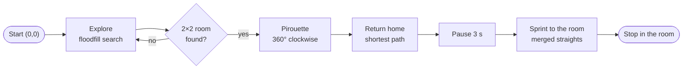
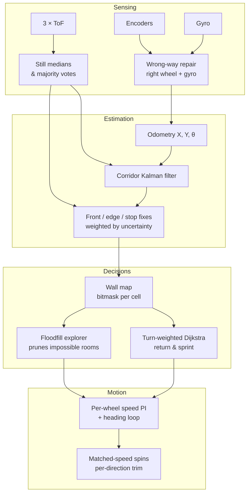

<div align="center">

# 🐭 Micromouse: Search, Celebrate & Sprint

**An autonomous maze-solving robot. One Python file runs in the course simulator and on the real mouse.**


*EEE3097S Engineering Design · University of Cape Town · Takudzwa Masendeke*

</div>

---

## The mission

The mouse starts in the corner of an unknown maze and has to:



It doesn't know the maze size or layout in advance. Touching a wall fails the run.

## Results

| | |
|---|---|
| **Course simulator** (5 graded seeds) | **98.6 / 100** |
| **Local autograder replica** | **59.16 / 60** |
| True 8×8 mazes | 99.0 / 100 |
| Board emulator, final build with gyro + encoder faults injected | 29 / 30 runs completed |
| Real mouse | full missions on Easy, Hard and Very Hard mazes; final demo build `v71j` |

## How it works



- **Exploration** is a multi-source floodfill (Dial's algorithm). Cells that could still complete a 2×2 room
  are cheapest. Cells no possible room can contain are skipped entirely, which saves 21–27% of the search time.
- **Room test:** 4 interior walls seen open and all 8 rim walls seen. If the search ends without a room,
  walls seen by a weak vote are re-checked with the front sensor.
- **Path planning** is a Dijkstra over (cell × heading) states, with turns costing extra, so the sprint takes
  long straight runs.
- **Position:**
  - Every fix (front wall, side-wall edge, still side medians) is weighted by an along-track uncertainty.
  - The walls correct the gyro heading at every stop.
  - Readings that don't add up to a corridor are ignored.
- **On the real mouse** it stops on every cell, senses standing still (80 samples per side), lines up on the
  front wall before each turn, and learns where to line up so each spin *ends* on the cell centre.

Full write-up: **[docs/architecture.md](docs/architecture.md)**

## The journey: 63 iterations

The commit history of this repository *is* the development history: one commit per version, dated when it
was built.

| Phase | Versions | What happened |
|---|---|---|
| Simulator | v15 | Floodfill + room detection + Dijkstra, 98.6 in the simulator |
| First real runs | v16–v27 | Corners clipped while turning. Measured the real motor model (dead-band 20/15, not 61) |
| Tuning on hardware | v28–v45 | Per-wheel speed PI, after-turn sideways fixes, slower speeds |
| Position model | v46–v52 | Along-track uncertainty, side-wall edge fixes, "any contact ends the run" |
| ⭐ **Golden v53** | v53 | **First complete mission under the no-contact rule**: equal-speed spins |
| Speed attempts | v54–v59 | Continuous exploration and faster settings, then back to stopping |
| STABLE | v60–v64 | v53's settings, slower, stop on every cell |
| Encoder fault | v65–v68 | The left encoder counted the wrong way: repaired with the gyro |
| Lane keeping | v69–v70 | Walls correct heading and position at every stop |
| Final | v71–v71j | Smarter search, per-direction spin trims, fault-tolerant sensing, demo |

The whole story, with the evidence from the run logs: **[docs/journey.md](docs/journey.md)**

## Repository layout

```
├── src/
│   ├── main.py            the solution (simulator + board in one file)
│   └── board/main.py      2-line launcher for the board (imports the compiled s4.mpy)
├── tools/
│   ├── board/             diagnostics run on the mouse: sidecal, spincheck, diag, hw_cal …
│   ├── sim/               simulator harness, board emulator with fault injection, reports
│   └── build_deploy.sh    compile with mpy-cross and copy to the mouse
├── logs/
│   ├── board/             every real-mouse run log, named by build and outcome
│   └── flight/            25 Hz flight-recorder dumps
├── docs/                  architecture, journey, hardware notes, testing, tuning
└── submissions/
    └── task1_square/      Submission 1: drive a square
```

## Quick start

```bash
pip install mpy-cross mpremote
./tools/build_deploy.sh          # compiles src/main.py -> build/s4.mpy and copies it to the mouse
```

Then press **SW1** on the mouse. The first log line is `S4 BUILD v71j CENTRE 31-Oct`.

The simulator and the board emulator in [`tools/sim`](tools/sim) run on top of the course framework
(UCT-Micromouse: physics simulator, autograder, mock `uct_mouse` module), which is not part of this
repository. See [docs/testing.md](docs/testing.md).

## Hardware lessons

The hardest problems weren't in the algorithm:
- A **left encoder** whose direction decoding failed intermittently: it counted backwards one day and lost
  most of its reverse counts the next. The final build never trusts it: the left wheel's travel comes from
  the right wheel and the gyro.
- **Tyres scrub** in spins: the wheels turn about 2× what the rotation implies.
- **ToF sensors** with 50% dropouts, and side readings that shifted when the wiring was re-tied.
- **A gyro zero** that varied from −0.1 to −1.7 deg/s between power-ups.

Every one of these was found from data. **[docs/hardware-notes.md](docs/hardware-notes.md)**

## Acknowledgements

- The course framework (STM32 firmware, MicroPython port, physics simulator, autograder) is
  [UCT-Micromouse](https://github.com/nicollsf/UCT-Micromouse) by F. Nicolls. It's not included here.
- Developed with AI assistance (Claude, Gemini), as noted in the source header.
